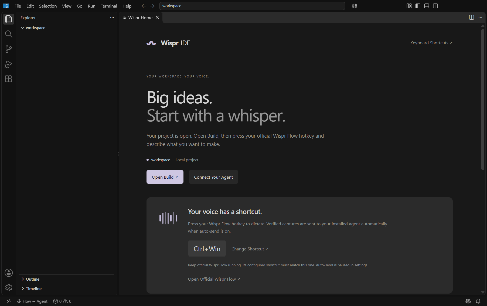
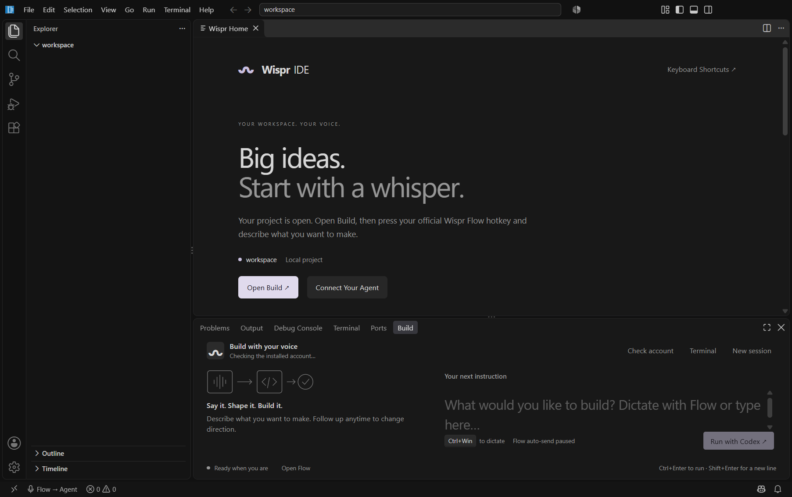
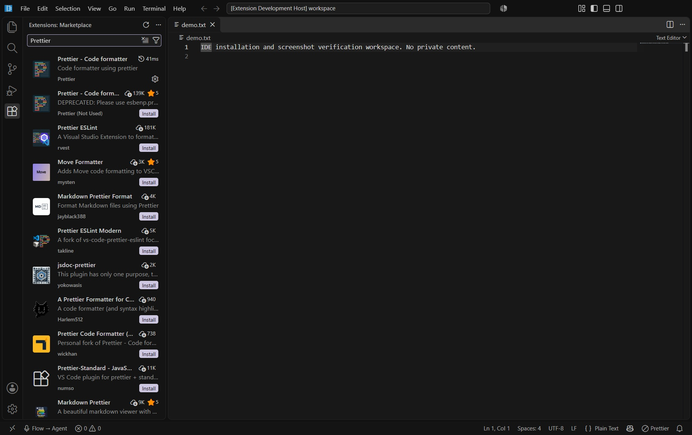

# Wispr IDE

### Speak freely. Build beautifully.

**Your voice, your agents, your editor.** A responsive **React + React Router DOM + Vite** product website with a dedicated downloads route and configurable Google website login.

[Quick Start](#quick-start) · [Components](#component-reference) · [Deployment](#deployment) · [Release Data](#release-data) · [Screenshots](#screenshots) · [Troubleshooting](#troubleshooting)

## Windows Preview

[Download the Windows x64 preview](https://github.com/garvit-arora/whif-ide/releases). Install official Wispr Flow first, then install the preview and sign in to your own Codex account. The preview is unsigned; see the release notes and checksum asset before installing. Model availability and provider limits still apply.

### A Home for Your Next Idea



### Voice and Text, in One Place



These captures come from a clean test profile. Auto-send is paused in that test profile to avoid intercepting physical dictation during automation; shipped defaults enable verified auto-send.

## Scope

Source files live at this Git repository's root. The application is a React single-page app with `/` and `/releases` routes, not separate HTML pages. `releases.html` is no longer a source file.

The desktop editor is a separate Code OSS/Electron product. This repository now includes its Wispr extension source and a desktop component guide under `product`; Windows preview installers are distributed as GitHub Release assets rather than committed binaries. Install official Wispr Flow before running the IDE installer. Installed Codex/Claude Code agents have separate accounts, access limits and billing. Google website login does not authenticate those agents.

## Quick Start

Use Node.js 22 or newer and the pinned pnpm version through Corepack. From the repository root:

```powershell
corepack pnpm install --frozen-lockfile
corepack pnpm build
corepack pnpm start
```

Open **http://127.0.0.1:4173**. Downloads are at **http://127.0.0.1:4173/releases**. `start` serves compiled `dist` output; rebuild after changing source. Stop with Ctrl+C. If Corepack is not provided by your Node distribution, use your approved Node setup to enable it or use pnpm 10.28.2 directly. Do not mix lockfiles/package managers.

### Hot-Reload Development

```powershell
corepack pnpm dev
```

Vite runs at **http://127.0.0.1:5173**. `/api` and `/auth` proxy to the Node backend on port 4173. Run `corepack pnpm start` in a second terminal when account endpoints are needed. For Google login through Vite, configure `PUBLIC_ORIGIN` as the browser-facing port-5173 origin and register its callback in Google. Without credentials, the UI reports that login is not configured.

| Script | Purpose |
| --- | --- |
| `corepack pnpm dev` | Vite development server |
| `corepack pnpm build` | Compile React, styles and public assets into `dist` |
| `corepack pnpm start` | Serve production output and auth endpoints |
| `corepack pnpm test` | Run mock-provider OAuth tests |

## Architecture

```text
index.html -> main.jsx -> BrowserRouter -> App
                                         |-- /         -> HomePage
                                         |-- /releases -> ReleasesPage
                                         |-- *         -> Not-found screen
                                         |-- Footer
                                         `-- AccountDialog

Browser /api and /auth -> serve.cjs -> auth.cjs -> Google OAuth
ReleasesPage -> public/releases.json -> GitHub published releases
Vite build -> dist -> Node or static hosting with history fallback
```

Internal navigation uses React Router DOM `Link`/`NavLink`, not page reloads. The app handles document titles, section-hash scrolling, top-of-page navigation and browser history. The desktop source uses a separate toolchain and is not built by these scripts.

## Component Reference

| File | Responsibility |
| --- | --- |
| `index.html` | Single Vite entry, metadata and React root |
| `src/main.jsx` | React root, Strict Mode, BrowserRouter and CSS imports |
| `src/App.jsx` | Route declarations, website account state, OAuth return status, titles, scrolling and shared layout |
| `src/HomePage.jsx` | Feature cards, workflow, agent explanations and FAQ; embeds Hero and Draft |
| `src/Hero.jsx` | Viewport-height pastel hero, navigation, cycling headline, download CTA and motion toggle |
| `src/useHeroMotion.js` | Single animation clock and frame; visibility/reduced-motion handling; cleanup on route unmount |
| `src/Draft.jsx` | Controlled textarea, character counter, clipboard copy and feedback |
| `src/ReleasesPage.jsx` | Downloads route, loading/empty states, search/channel filters and release cards |
| `src/releases.js` | Abortable release loading, bounded pagination, timeouts, local fallback and safe URL checks |
| `src/AccountDialog.jsx` | Native modal for Google website login/logout and separate desktop-agent setup instructions |
| `src/Footer.jsx` | Shared footer, internal links and Powered by Flow mark |
| `src/style.css` | Shared typography, section/card styling and baseline responsive rules |
| `src/hero.css` | Workflow, agent and FAQ styling; also retains earlier hero rules unused by the current hero |
| `src/vela.css` | Current pastel hero, notch, viewport layout, branding, draft/modal and downloads refinements |
| `public/releases.json` | GitHub repository and optional manual fallback entries; copied into `dist` |
| `public/_redirects` | SPA history fallback for compatible static hosts |
| `vite.config.js` | JSX compilation and development auth/API proxy |
| `vercel.json` | Static Vite build/output configuration and downloads-route rewrite |
| `serve.cjs` | Built asset serving, SPA history fallback, security headers and auth delegation |
| `auth.cjs` | Server-only Google state/PKCE/nonce checks, signed token verification, sessions and logout |
| `auth.test.cjs` | Test signing keys/mock responses for OAuth, replay, sessions, Host and logout-origin behavior |
| `package.json`, `pnpm-lock.yaml` | Commands, dependencies and reproducible installation inputs |
| `AUTH.md` | Google credentials, callbacks, identity boundaries and production requirements |
| `SECURITY.md` | Review scope, protections and remaining hardening |
| `.gitignore` | Excludes dependencies, build output, logs and environment secrets |

## UI and Interaction

The hero and cream strip fit inside `100svh`. Build, Speak, Shape and Create cycle with pastel tones and local candy-style typographic icons, adapting the supplied Vela reference. These are not the reference's remote photographs. Motion pauses in hidden tabs, supports manual pause and defaults off for reduced motion. No GSAP CodePen was supplied or integrated.

Product details remain below the hero. Every internal IDE download link goes to `/releases`; Flow setup links remain external. FAQ uses native disclosure elements. Remote release notes render as React text, not executable HTML.

The draft is temporary: it is not saved or sent to a provider, and route changes/reloads discard it. Wispr Flow can insert text into the focused textarea through its installed app. Copy the draft to the desktop Build panel to execute. The browser does not verify Flow installation, collect audio or access local agent sessions. Clipboard failure offers manual selection/copy.

## Deployment

### Static Hosting

1. Set repository/project root to `.` and choose the Vite preset.
2. Set build command to `corepack pnpm build` and publish/output directory to **`dist`**.
3. Configure SPA history fallback: `/releases` must return `index.html`, while real assets retain their normal paths.
4. Test loading and refreshing `/releases` directly, not only navigation from the homepage.

The included `_redirects` supports compatible platforms such as Netlify; `vercel.json` provides a Vercel downloads-route rewrite. Configure equivalent rules elsewhere. Do not rewrite `/api` or `/auth` to HTML when a backend is connected.

Publish only built `dist`, never `.git`, server source, tests, environment files or logs. Static hosting supports the product/release UI but **cannot run Google OAuth endpoints**. A rewrite is not an authentication backend.

GitHub Pages does not natively supply BrowserRouter fallback for arbitrary deep paths. Use a compatible fallback or a host with SPA rewrites. For subpath hosting, build with the appropriate Vite base, such as `corepack pnpm build --base=/whif-ide/`; the router and manifest fetching use that base. Configure a matching host fallback.

### Node Hosting and Google Login

Build first, then start the Node server behind an HTTPS reverse proxy. Configure secrets in the host dashboard or secret manager:

| Variable | Meaning | Default |
| --- | --- | --- |
| `HOST` | Listen interface; containers may require `0.0.0.0` | `127.0.0.1` |
| `PORT` | Port assigned by the host | `4173` |
| `PUBLIC_ORIGIN` | Exact external browser origin | `http://127.0.0.1:4173` |
| `GOOGLE_CLIENT_ID` | OAuth web client identifier | Not configured |
| `GOOGLE_CLIENT_SECRET` | Confidential server-side OAuth secret | Not configured |

Register `<PUBLIC_ORIGIN>/auth/google/callback` with Google. The reverse proxy must preserve the expected external Host header. Read [AUTH.md](AUTH.md) for consent-screen setup and callback/session details. Never use a `VITE_` environment variable for a secret; those values can be exposed to the browser bundle.

The server exposes built assets and the SPA shell, not backend source. Its old `/releases.html` URL redirects to `/releases`; no separate release document exists. Production still requires shared expiring sessions, rate limiting, a maintained authentication solution, monitoring, cached release data and deployment security review. In-memory sessions reset on restart and do not span instances. This implementation is not a certification for millions of concurrent users.

## Release Data

`public/releases.json` selects `garvit-arora/whif-ide`. The downloads route reads published releases/assets from GitHub; drafts are excluded and previews are filterable. Loading cancels on route exit, has per-request timeouts and caps pagination at 2,000 entries. Anonymous limits apply; use a cached manifest/backend for scale. Never embed GitHub tokens in frontend code.

Pushing source does not create an EXE. Publish a real tested installer as a GitHub Release asset. The HTTPS GitHub URL allowlist is not proof that an artifact is signed or scanned.

The prominent Get button targets the newest stable release by publication date. If no stable release exists, it offers the newest preview with an explicit Preview/unsigned-test-build label. It selects a safe `.exe` asset, preferring x64/amd64 and excluding ARM64/32-bit names. A preview never replaces an existing stable release. Each release also has a version-specific Get button. If the selected release has no matching EXE, the main button stays disabled instead of silently delivering an older version. Data refreshes every minute while visible and on returning to the tab. Downloads require a click; normal browser save/security prompts still apply. Downloading never runs the installer.

For manual maintenance, leave `repository` empty and add GitHub-compatible entries:

```json
{
  "repository": "",
  "releases": [
    {
      "name": "Your actual release title",
      "tag_name": "vYOUR_VERSION",
      "published_at": "2026-11-04T00:00:00Z",
      "prerelease": true,
      "body": "Actual changes and known limitations.",
      "html_url": "https://github.com/OWNER/REPOSITORY/releases/tag/vYOUR_VERSION",
      "assets": []
    }
  ]
}
```

Replace example values and add real assets using `name` and `browser_download_url`. Local entries are also the fallback on GitHub failure. Rebuild after changing public data before serving production output.

## Tests and Verification

```powershell
corepack pnpm test
corepack pnpm build
```

The build validates JSX/imports and creates browser bundles. OAuth tests use mock Google responses and generated keys to cover browser state, signed callbacks, replay, bad signatures, Host checks, sessions and logout origins. They do not prove a real Google login.

After changes, check internal links, direct route refresh, browser back/forward, hash navigation, filters, loading/failure/empty states, keyboard modal controls, reduced motion and mobile/short-landscape fit. Google credentials, installed agents and physical Flow behavior require separate live validation.

## Screenshots

1. Capture the homepage, `/releases`, and a non-sensitive desktop demo if documenting the editor.
2. Hide credentials, private code, email addresses and personal paths.
3. Create `images` beside the README and add compressed PNG/WebP files.
4. Embed screenshots only after the files exist:

```markdown


```

For images displayed inside React, import from `src` or place them in `public` and rebuild. Documentation screenshots do not need to ship in `dist`. Do not represent website illustrations as working desktop screenshots.

## Troubleshooting

| Problem | Resolution |
| --- | --- |
| Host cannot find output | Run Vite build and publish `dist` from repository root. |
| `/releases` refresh returns 404 | Add the host's SPA history fallback. |
| Source changes do not appear | Production serves `dist`; rebuild or use Vite dev mode. |
| Login unavailable on static hosting | Connect a real Node/auth backend; static files cannot implement OAuth. |
| Google redirect mismatch | Match public origin, port and callback path exactly. |
| API returns HTML | A static SPA rewrite swallowed `/api`; route backend requests first. |
| Session disappears after restart | Expected with in-memory sessions; production needs a shared expiring store. |
| Port in use | Reuse/stop the owned preview or configure another port and matching origin. |
| Release API fails | Check visibility, network/API limits and fallback entries. |
| No installer | Upload a real binary to a GitHub Release; a source push is insufficient. |
| Draft does not execute | Browser-to-desktop execution is not implemented; use the desktop Build panel. |

## Desktop and Publication Boundaries

The desktop product uses Electron, Monaco, Code OSS services and `extensions/wispr-flow` for installed-agent discovery, Build UI, terminal routing, verified Windows Flow handoff and separate MCP account context. See [the product component guide](product/README.md), [extension source](product/desktop-extension), and [preview setup/limitations](product/packaging/RELEASE-NOTES.md). Preview installer assets are unsigned. The IDE tool bridge is structured context and approved command execution, not unrestricted screenshot-based desktop control.

Before releasing desktop code/binaries, review licenses, secrets, physical dictation, provider generation/steering/interruption, platform install/uninstall, signing and checksums. Website Google identity is separate from agent authentication and cannot remove provider limits.

Changes remain local until an explicit push request. A commit, push, deployment and binary release are different actions. Do not commit secrets, profiles, transcripts, signing certificates, cookies or logs.

## Security and References

See [SECURITY.md](SECURITY.md) and [AUTH.md](AUTH.md). This is not an independent audit certificate.

Architecture references: [React Router routing](https://reactrouter.com/start/declarative/routing), [Vite production builds](https://vite.dev/guide/build), [Google web-server OAuth](https://developers.google.com/identity/protocols/oauth2/web-server). The [IDE reference review](product/IDE-REFERENCES.md) compares Zed, Continue and VSCodium and distinguishes future options from shipped features.

### Preview 2 Extension and Screen Tools

Preview 2 fixes extension gallery failures, verifies installs before reporting success, and adds explicitly approved IDE-window screenshots for Codex. Open VSX whole-package signatures are validated using the [registry-specific verifier](product/signature-verifier/README.md); proprietary Microsoft verifier binaries are not redistributed and signature checks are not disabled. Native publisher-trust prompts remain separate approvals. Only Open VSX extensions are supported, not every Microsoft Marketplace listing.



This is a captured test workspace with no private project content. For verification results and remaining limitations, see [release verification](product/packaging/verification.json). Screenshots can reveal visible code or secrets; inspect the window before approving image sharing with your provider.
